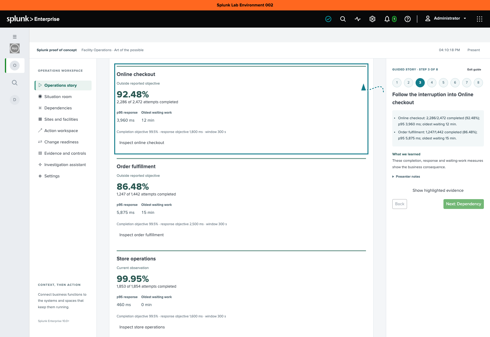

# Facility Operations

A native Splunk app and proof of concept for understanding **what is affected, why it may be happening, who should investigate, and what evidence is needed for the next decision**.

The installed experience uses Splunk Web's own bar, app navigation, account controls and Search page. Inside that frame, Splunk UI Toolkit components support a richer operations workspace and an investigation assistant. It is an **art-of-the-possible demonstration** for customer discovery and a starting point for a scoped proof of concept.

Facility Operations follows specific business handoffs—clinical order acknowledgements, benefit decisions, manufacturing quality release, checkout acceptance, payment acknowledgements and property check-in—through their supporting services and facilities. It demonstrates how an operations dashboard can become an investigation and decision workspace: follow dependencies, compare observations, review ownership, discuss recovery, and produce a briefing from the same evidence.

The intended value is less time spent proving that an unaffected service or team is clear, fewer unnecessary handoffs, and faster, better informed decisions. These are outcomes to measure in a customer proof of concept; this release does not claim measured time savings or return on investment.



Guided presentation on Splunk Enterprise 10.4 with native chrome, using the Retail and Commerce / Executive context. The default **Operations story** follows one case. Choose **Start guided walkthrough** or **Start three-minute overview**; the desktop guide has its own reading column and the sidebar labels align on the left. The [industry walkthroughs](docs/industry-scenarios.md) show clinical and manufacturing examples. See the [installed investigation assistant](docs/images/case-investigation.png) for the evidence-to-report workflow.

## Start with your role

| I want to… | Read this |
| --- | --- |
| Present an operations story without writing searches | [Presentation guide](docs/demo-guide.md): preparation, five-minute and ten-minute walkthroughs, expected behavior |
| Discuss business value and define a proof of concept | [Operations value and evaluation](docs/operations-value.md): time to innocence, discovery questions, measures and acceptance criteria |
| Download and install the app in Splunk | [Getting started](docs/getting-started.md#download-and-install-from-github): release installer, browser installation, requirements and first checks |
| Connect real operational observations | [Live data guide](docs/live-data.md): source, inventory, field contract and verification |
| Configure the investigation assistant | [Assistant setup](docs/assistant-setup.md): deterministic demo, Ollama, OpenAI and Splunk AI Toolkit |
| Demonstrate an evidence-driven decision | [Investigation workflows](docs/investigation-workflows.md): component handoff, audience briefings, field meanings and evidence limits |
| Resolve an issue | [Troubleshooting](docs/troubleshooting.md): symptoms, checks and recovery steps |
| Understand or extend the implementation | [Architecture](docs/architecture.md) and [contributor guide](docs/contributing.md) |
| Check what has actually been tested | [Validation](docs/validation.md) and its sanitized lab receipts |

New to the terminology? See the [glossary](docs/glossary.md). Initial public sector discovery is documented in [customer research](docs/customer-research.md); it is supporting context for generic operations demonstrations.

## What you can demonstrate today

- **One operational case:** a plain-language finding, business consequences, evidence and audience decision; completed investigations remain available across workspaces during the current page session. Download a customer brief with current observations, frozen investigation findings, recorded decisions and customer proof-of-concept requirements.
- **Business delivery:** completed/attempted transactions, completion objectives, p95 response, aging work and source signatures for three distinct workflows per vertical.
- **Diagnostic comparison:** token acquisition, gateway failures, database waits, circuit loss, UPS reserve and cooling observations with source evidence.
- **Industry decisions:** continuity and recovery questions, recognizable system equivalents and primary design references. See the [industry scenario catalogue and concrete walkthroughs](docs/industry-scenarios.md).
- **Operational briefings:** audience-specific decisions, a shared-dependency hypothesis, accountable teams, healthy counter-evidence and explicit gaps. Start a focused investigation directly from the workspace.
- **Dependency investigation:** an interactive map linking business functions, technology and site conditions, with potential downstream impact and event chronology.
- **Several audiences, one incident:** Operations, Security, Engineering, Executive, Chief Information Security Officer (CISO), Information System Security Officer (ISSO), Change Control Board (CCB), Facilities, Continuity, and Audit and Oversight.
- **Several operating contexts:** sixteen verticals and six use-case families covering shared dependency disruption, cyber and physical continuity, containment, change readiness, modernization and governed autonomy.
- **Guided presentations:** a paused baseline, a five-stage overview and an eight-step click-through story with a dedicated desktop guide column, automatic evidence positioning, highlight, arrow, Next/Back and visited-stage export. The continuous replay remains an explicit option. No continuously ingested demo source is required.
- **An investigation assistant grounded in the dataset:** the selected audience, component, data purpose and field meanings accompany computed operational facts. Watch search and model activity, read incremental formatted answers, inspect cited evidence and event sequences, draft briefs, and export text, JSON evidence and executed SPL.
- **Governance conversations:** examine evidence, approval, rollback and recovery gates through clearly labeled simulations.
- **A separate live path:** authenticated Splunk searches use the signed-in user's data permissions. Missing or stale telemetry remains unknown.

The catalogue supports commercial and public sector organizations. Retail, manufacturing, logistics, financial services, technology and SaaS, commercial properties, and hospitality have business functions, owners, sites and incident stories appropriate to their operations. Enterprise Shared Services uses neutral workforce, finance and employee-support language. See the [commercial demonstration guide](docs/commercial-demo.md).

## Download and install

Download the ready-to-install [Facility Operations 0.1.7 `.tar.gz` installer](https://github.com/LeiterConsulting/splunk-facility-operations/releases/download/v0.1.7/splunk_facility_operations-0.1.7.tar.gz), or open [GitHub Releases](https://github.com/LeiterConsulting/splunk-facility-operations/releases/latest) for release notes and assets.

In Splunk Web, an administrator opens **Apps → Manage Apps → Install app from file**, selects the downloaded `.tar.gz`, and uploads it. Keep the archive compressed. The release includes the compiled interface and demonstration data; Git, Node.js, npm and a source build are not required to install it.

Follow the [download and installation guide](docs/getting-started.md#download-and-install-from-github) for first installation, upgrades and verification. Choose the named installer under **Assets**; GitHub's automatically generated **Source code** archives require a build.

## Component preview for developers

For someone building the package: use Node.js 20.19+ with npm and Python 3.9+. From the repository root:

```sh
npm ci
npm run package
npm run preview
```

This preview checks React components outside Splunk; it has no Splunk chrome, authentication or search service and is labeled **Developer component preview**. Present the proof of concept from the installed app in Splunk Web.

Open [the local preview](http://127.0.0.1:5174). Open **Settings → Presentation setup**, choose **Operations**, **Public Services and Benefits**, and **Enterprise Dependency Disruption**, then choose **Apply presentation**. Select **Demo**, choose **Pause**, then **Impact**, and open **Dependencies**.

A presenter with an already installed app can open **Facility Operations** from the Splunk app menu and follow the same walkthrough. The local preview uses synthetic observations and the deterministic assistant. Real searches and configured model connections require installation in Splunk.

The build creates `artifacts/splunk_facility_operations-0.1.7.tar.gz`, an identical `.spl` installer, and `SHA256SUMS`. These generated files are ignored by Git and distributed through GitHub Releases.

Settings can discover OpenAI account models, installed Ollama models and AI Toolkit's configured LLM connections. Manual identifiers remain available. Direct OpenAI/Ollama connections support adaptive or fixed reasoning where the model permits it; investigation details show call duration and available token counts. Follow the [assistant setup guide](docs/assistant-setup.md) for permissions, capability checks and model qualification.

## Proof-of-concept scope

The native app was checked on Splunk Enterprise **10.0.1 and 10.4.0**, using Splunk UI Toolkit components and Enterprise themes. Baseline searches use SPL; there are no shipped SPL2 modules. Other versions and deployment topologies need their own qualification. [Validation scope](docs/validation.md)

Dependency relationships come from the supplied inventory. Chronology and relationships support investigation hypotheses; they do not independently prove cause. Audience selection changes the presentation and grants no permissions. Audience, industry and use case are configured together in Settings and remembered in this browser; the dashboard shows their active labels and keeps the Demo/Live switch visible. Valid shared-link context overrides remembered preferences.

All action execution is a browser-session simulation. Reports are downloadable drafts, and investigations and decisions are not a durable incident record. The deterministic assistant uses templates without an LLM. OpenAI `gpt-6-luna` has been exercised against synthetic demo evidence on the installed lab. Other models, Ollama, AI Toolkit and customer data require separate qualification. Provider failure is shown as an error; presenters can explicitly select and save the deterministic assistant to continue.

For a customer proof of concept, agree the business function, sources, dependency authority, evidence coverage, sampling interval, access roles and success measures before evaluating the live path. [Evaluation guide](docs/operations-value.md#plan-a-customer-proof-of-concept)
