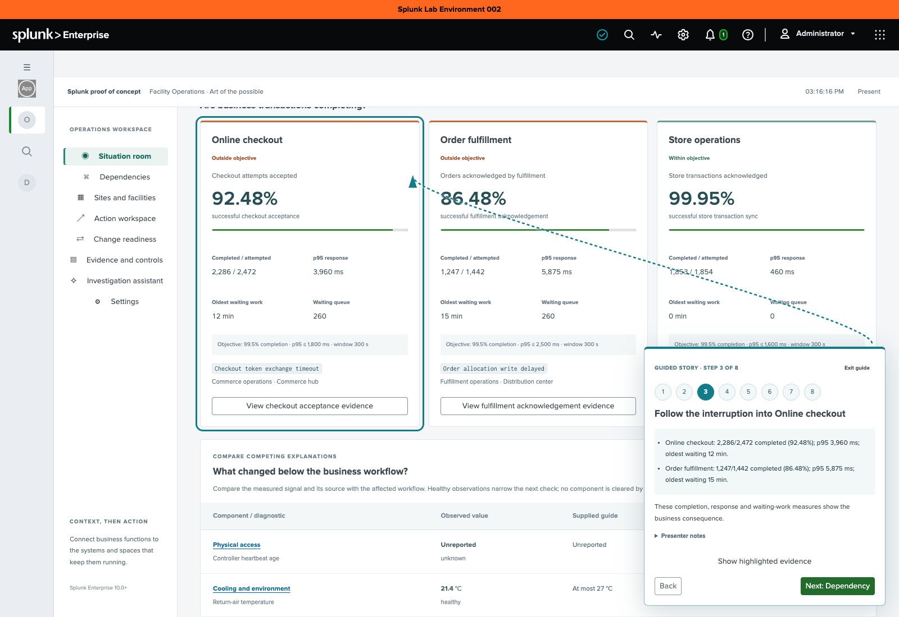

# Facility Operations presentation guide

Start with **Start guided walkthrough**. The app opens at a paused business baseline, and eight steps bring each change into view. A pinned guide explains the current evidence, highlights the relevant area and supplies Next/Back controls. Presenters do not need to memorize which panel changes or scroll ahead of the replay.

For business value and evaluation measures, use [operations value](operations-value.md). For concrete clinical, manufacturing and retail examples, use [industry scenarios](industry-scenarios.md).

## Prepare and rehearse

1. Open **Facility Operations** inside Splunk Web. Confirm the native Splunk bar and app navigation. Use the installed app for a Splunk proof-of-concept presentation; the local [component preview](getting-started.md#build-and-preview-from-source) is for development.
2. In **Settings → Presentation setup**, choose the audience, industry and use case, then **Apply presentation**. These choices also supply the walkthrough's business context, dependency, owners and decision questions.
3. Select **Demo**, then **Start guided walkthrough**. The guide starts at Normal, pauses the scenario and brings the relevant business card into view. It uses an observe/recommend policy and clears a prior demo approval; it does not change the configured model connection.
4. Advance with **Next**. **Back** and the numbered steps let you revisit a point. **Show highlighted evidence** returns the camera to its target after you explore or scroll away. The workspace scrolls inside the installed Splunk frame while the guide is active.
5. The assistant step prepares a question for review. Choose **Investigate** to use the saved provider. With the deterministic provider, no external model is needed. With a connected provider, this is the explicit point at which inference starts. Use **Next: Decision** to skip an investigation you do not want to run.
6. Rehearse the final **Download story evidence**. It contains the normalized observations and SPL from stages actually visited. Download an assistant report/evidence separately before leaving its step.

Opening statement: “This is a native Splunk proof of concept using synthetic operating evidence. We will follow one business interruption from its first signal to its consequences, an investigation, a decision and the checks needed for recovery.”

## A five-minute walkthrough

| Step | What comes into view | Conversation |
| --- | --- | --- |
| 1. Baseline | A business handoff's normal completion, response and waiting work | What does this organization need to complete, and what counts as success? |
| 2. First signal | The use case's diagnostic row | A dependency signal changes before business handoffs degrade in this authored story. What should be checked next? |
| 3. Business impact | An affected business card and the returned measures | Which handoffs are delayed? Which continue? Compare completion and response with the supplied demo objectives. |
| 4. Dependency | The map, with the scenario component selected | Which configured path could explain the symptoms, and which team owns the next check? A path is a hypothesis, not causal proof. |
| 5. Investigate | A prepared assistant question; activity and response after submission | Review the question, then Investigate. Watch searches and model/tool activity, compare the answer with its evidence and export a useful brief. |
| 6. Decision | The scope, evidence, rollback and approval runbook | What can proceed, what needs review and what independent evidence is missing? Next previews recovery; it does not approve or execute a plan. |
| 7. Recover | Improving completion and response, with work still waiting | Improvement alone is not recovery. Check the queue and completion objective. |
| 8. Verify | Fresh synthetic recovery observations | Reconcile the named handoff with the accountable source. Download the visited-stage evidence, restart, finish or choose another presentation. |

The guide advances only after all expected demo entities have returned the selected stage. During a refresh, its evidence summary stays empty until matching results arrive. If a stage cannot load, use **Retry stage search** or **Exit guide**. It does not invent a successful search or advance on a timeout.

## A ten-minute walkthrough

Complete the eight steps and spend more time on the assistant and decision:

1. In Investigate, review the prepared audience question and submit it. The guide moves the highlight to actual activity and the response. Next/Back/step jumping stay disabled while the investigation runs. Wait for completion or use **Stop**. No query or model request starts merely because you entered the step.
2. Inspect a returned component citation, chronology and tool searches. Discuss healthy counter-evidence and missing observations before asserting cause. Use **Export report**, **Export evidence** and **Export searches** before advancing.
3. In Decision, review the runbook with the audience. The default guide previews authored recovery when you choose Next. To demonstrate a recorded simulation, deliberately select the supervised policy, review its gate, record demo approval and run the simulation. Successful simulation advances the guide to Recover; no external infrastructure changes.
4. In Verify, discuss the independent source reconciliation needed for a real incident. Queue entries may overlap and a workflow acknowledgement is not final settlement, fulfillment or a clinical outcome.
5. Download **operations-guided-story.json**. It records visited stage IDs, phase clocks, capture times, normalized observations and executed dashboard SPL. Skipped stages are not fabricated; restarting clears the previous walkthrough's stage snapshots. Assistant narratives are separate downloads.

Time-to-innocence, recovery speed and financial savings require a [customer evaluation](operations-value.md#plan-a-customer-proof-of-concept). Replay duration and authored phase transitions are not measured improvements.

## Explore freely or use the continuous loop

**Exit guide** or **Finish walkthrough** removes the highlight and arrow and leaves the current phase paused. The same workspaces, source inspection and assistant remain available.

Choose **Play continuous loop** to run the eight-phase replay without guided camera movement. Use **Pause**, phase buttons and **Resume** for a manually controlled demonstration. A link with `replay=loop` explicitly starts this playback style; default links open a paused baseline. **Present** still retains native Splunk chrome and offers a workspace selector when the sidebar is hidden.

Opening another workspace during a guide does not force you back. **Return to this step** restores its view and evidence target. Applying another presentation ends the current guide and returns guided playback to its baseline. Switching to **Live** ends the walkthrough; authored phase controls and guide actions are unavailable in Live.

## Keyboard and compact screens

Use Tab/Shift+Tab and Enter for ordinary buttons. The guide announces the current step, focuses its heading on advancement, and supports Escape while focus is inside its controls. It is a nonmodal guide; the workspace and native Splunk navigation remain usable. Reduced-motion preference removes the arrival animation and smooth scrolling.

On compact screens the guide keeps its controls visible, uses the same automatic evidence positioning and outline, and omits the connecting arrow to reduce obstruction. Detailed operating context is available in **Presenter notes**.

## If the presentation needs attention

| Symptom | Check |
| --- | --- |
| Nothing advances automatically | The default guided demo is intentionally paused. Choose Start guided walkthrough and Next, or Play continuous loop. |
| Next is disabled | Wait for matching stage evidence or for the active investigation. Retry a failed search; stop an investigation explicitly if needed. |
| You explored away from the highlighted view | Choose Return to this step or Show highlighted evidence. |
| A model is unavailable | Exit to Settings and test the saved connection. The deterministic provider can demonstrate evidence analysis without external inference. |
| Live is empty | Onboard inventory and normalized sources using the [live guide](live-data.md). Empty coverage remains unknown. |

Use [troubleshooting](troubleshooting.md) for installation, caches, provider connectivity and data-contract checks.
