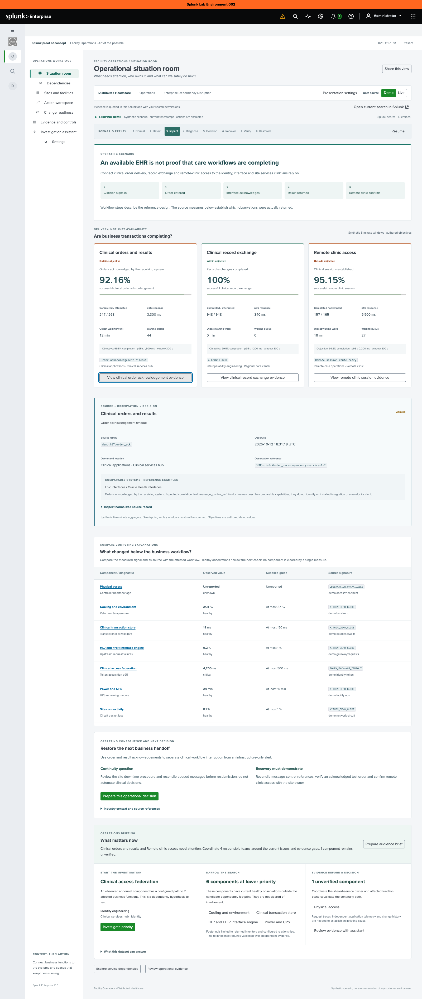
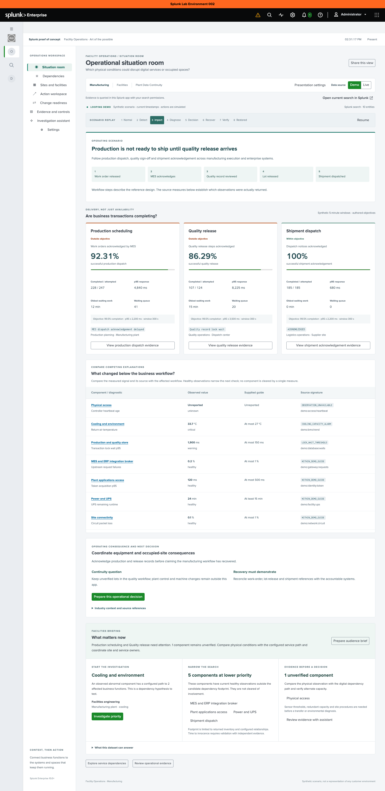

# Industry operating scenarios

Use these scenarios to demonstrate the path from a business handoff to its source observations, diagnostic comparisons, accountable decision and recovery check. Each vertical has three measured business workflows and a supporting technology/site reference design. Changing the vertical changes transaction volumes, objectives, source families, ownership and dependency paths.

Choose a context in **Settings → Presentation setup**. Select **Operations**, apply the presentation, then open **Situation room**. For these manual exercises, choose **Play continuous loop**, then pause at **Impact** to inspect the figures below. Keep Splunk’s native Search available to show where the observations came from.

## Scenario catalogue

| Vertical | Business handoffs | Comparable system roles | Operating problem to explore |
| --- | --- | --- | --- |
| Public Services and Benefits | Eligibility decision; Authorization acknowledgement; Payment reconciliation | Salesforce Public Sector Solutions; HL7 FHIR R4 payer APIs; ERP payment operations | A portal can be available while eligibility decisions are stuck downstream. |
| Enterprise Shared Services | Workspace launch; Finance approval; Support resolution | Microsoft 365; SAP S/4HANA; ServiceNow ITSM | A healthy collaboration tenant can still be inaccessible through federation. |
| Distributed Healthcare | Clinical order acknowledgement; Clinical record exchange; Remote clinic session | Epic interfaces; HL7 FHIR servers; Virtual desktop / EHR access | Clinical orders can queue in an interface engine while the EHR login page stays green. |
| Regulated Science and Research | Sample result acceptance; Submission intake; Research record retrieval | LabWare LIMS; eCTD submission gateways; Veeva Vault | Instrument results can arrive without the audit evidence needed for release. |
| Defense and Mission Support | Task acknowledgement; Supply requisition; Protected session | Mission workflow systems; SAP logistics workflows; Enterprise secure collaboration | Supporting IT can be green while task acknowledgements stall. |
| Oversight and Accountability | Case intake; Evidence retrieval; Publication workflow | Dynamics 365 case management; SharePoint; Document review workflows | Collecting documents does not establish completeness or provenance. |
| Legislative and Cultural Institutions | Session delivery; Preservation verification; Public object delivery | Streaming encoders / CDN; Preservation repositories; Digital asset management | A live encoder can be healthy while public delivery fails. |
| Global and Diplomatic Services | Appointment submission; Collaboration launch; Remote case handoff | Public appointment portals; Microsoft 365; Distributed case workflows | A central service can be healthy while a remote post cannot reach it. |
| Critical Infrastructure | Service-event acknowledgement; Dispatch work order; Maintenance evidence | SCADA information gateways; IBM Maximo; Enterprise asset management | Historian data freshness can fail independently of physical service delivery. |
| Retail and Commerce | Checkout acceptance; Fulfillment acknowledgement; Store transaction sync | Shopify commerce; Manhattan Active OMS; Oracle Retail POS | A storefront can be reachable while checkout token exchange times out. |
| Manufacturing | Production dispatch; Quality release; Shipment acknowledgement | Siemens Opcenter; SAP quality management; SAP logistics | A production order can be dispatched while the quality-release handoff is blocked. |
| Logistics and Distribution | Warehouse pick confirmation; Fleet dispatch acceptance; Delivery event ingestion | Manhattan Active WMS; Oracle Transportation Management; GS1 EPCIS event feeds | Warehouse completion can conceal an unacknowledged dispatch manifest. |
| Financial Services | Banking session launch; Payment acknowledgement; Fraud-review handoff | Digital banking channels; ISO 20022 payment hubs; Fraud case management | Customer access, message acceptance and settlement are different operational states. |
| Technology and SaaS | Customer sign-in; API transaction; Support event delivery | Auth0; Kubernetes services; ServiceNow | Healthy CPU and memory do not prove that customer requests succeed. |
| Commercial Properties and Workplace | Tenant request acceptance; Building work-order dispatch; Workplace access request | Tenant service portals; IBM Maximo; LenelS2 | A building platform can be online while equipment faults and comfort complaints accumulate. |
| Hospitality | Reservation acknowledgement; Property check-in; Guest-service handoff | Oracle OPERA Cloud; Oracle OPERA PMS; Property business-event interfaces | A reservation can exist centrally while the property interface has not received it. |

Product names identify comparable capabilities in a reference design. They do not identify a customer’s installed stack, a bundled connector, a supported vendor integration or an incident involving that vendor. `demo:*` source families belong to this synthetic application; they are not advertised Splunk add-on sourcetypes.

For a click-through presentation that brings each observation into view, use **Start guided walkthrough** and the [guided presentation guide](demo-guide.md).

## Three demonstrations with concrete evidence

### Clinical order acknowledgement and remote clinic access

Choose **Distributed Healthcare / Operations / Enterprise Dependency Disruption**, then **Impact**. The order interface reports **247 successful acknowledgements out of 268 attempts**, **92.16% completion**, **3,300 ms p95** and **12 minutes** for the oldest waiting work. Its authored objectives are 99.5% completion and 1,500 ms p95. The source is `demo:hl7:order_ack`; the signature is **Order acknowledgement timeout**.

Compare record exchange, which retains healthy evidence, with remote clinic access, which also depends on the clinical access broker. Inspect token acquisition at **4,200 ms** against its 500 ms demo guide; database lock wait remains **18 ms** and circuit loss **0.1%**. These observations motivate checking the access path before escalating every application team. The configured topology and time sequence support a hypothesis; they do not prove a cause.

Open the order evidence card. Explain the comparable Epic/Oracle Health interface role and the expected production correlation field `message_control_ref`. The shipped observation reference identifies an aggregate, so it cannot establish that the same individual clinical order appeared at every handoff. A customer proof of concept should bring message acknowledgements, interface errors, duplicate/retry handling and reconciled order references from the accountable systems. Do not include patient identifiers in the assistant contract.

Ask **Explain which business handoffs are failing**, inspect its returned evidence and export it. Discuss whether a reviewed downtime workflow is available and what receiving-system acknowledgement would demonstrate recovery.

### Manufacturing quality release and change review

The screenshot shows the related facility-continuity lens; the change-review exercise below uses the same business handoffs with a deployment and database-wait hypothesis.

Choose **Manufacturing / Change Control Board / Quality Platform Change Readiness**, then **Impact**. In Situation room, quality release reports **107 / 124** successful observations, **86.29% completion**, **8,225 ms p95**, and **15 minutes** oldest waiting work. Production dispatch also degrades; shipment acknowledgement remains healthy. The database reports **1,900 ms lock wait** against a 150 ms guide.

Inspect the quality source `demo:qms:release` and its synthetic deployment reference `DEMO-CHG-MANUFACTURING-042`. Use **Prepare this operational decision** to carry the operating context and rollback/acceptance questions into the assistant. Compare the temporal association with the healthy identity and network evidence. Approval, the authoritative change diff and a verified rollback plan remain separate evidence to obtain.

Frame the outcome around work-order, lot-release and shipment reconciliation. A recovered database does not establish that held quality records were correctly released. Manufacturing execution, quality and ERP examples are workflow roles, not authorization to control production equipment.

### Retail checkout and fulfillment

Choose **Retail and Commerce / Executive / Checkout and Fulfillment Access**, then **Impact**. Checkout reports **2,286 / 2,472** successful step observations (**92.48%**) and **3,960 ms p95** against an authored 1,800 ms objective. Fulfillment acknowledgements also degrade; point-of-sale synchronization remains healthy. The checkout source signature is **Checkout token exchange timeout**.

Compare the access-broker token p95 with the database and circuit observations. Discuss preserving idempotency keys and reconciling storefront/OMS order references before replaying acknowledgements. Attempted checkout, order acceptance and fulfillment are different business steps; the demo does not translate failures into abandoned baskets or lost revenue.

Export an executive draft and the evidence JSON. Verify that completion counts and source signatures in the draft match the returned rows. Then demonstrate the engineering lens using the same evidence and compare what each audience needs to decide.

## Six use-case families

| Family | Distinguishing observation | Decision and independent verification |
| --- | --- | --- |
| Shared dependency | Token acquisition p95 rises to 4,200 ms | Compare affected handoffs with healthy database/circuit evidence; verify receiving-system completion |
| Cyber and physical continuity | Return-air temperature reaches 33.7 °C; dependent data workflows degrade | Coordinate site and service owners; inspect actual equipment limits and alternate capacity |
| Containment | 164 rejected client-certificate requests in a five-minute observation | Validate certificate and access evidence, then compare interruption risk before isolation; rejection alone is not compromise |
| Change readiness | 1,900 ms database lock wait and an associated synthetic deployment reference | Inspect change scope, authorization, rollback and workflow acceptance evidence |
| Modernization | 14.2% circuit packet loss | Test remote-site handoffs and readiness; a healthy central component does not establish branch readiness |
| Governed autonomy | Standby connection-pool utilization reaches 98% | Review the bounded simulation, ownership and independent acceptance checks; no infrastructure action is executed |

All numbers in this table are authored demonstration observations. A real deployment needs source-specific measures, service-owner-approved objectives and operational procedures.

## How to evaluate operational value

Use the [proof-of-concept evaluation](operations-value.md#plan-a-customer-proof-of-concept) to measure time to the first useful hypothesis, time to narrow unaffected candidates, evidence completeness, owner handoffs and the time required to prepare an accepted decision brief. Start with one real workflow and the sources needed to validate a transaction across its handoffs. Compare results with the current investigation process. Replay duration is not a measured time saving.

## Primary design references

Reviewed October 12, 2026. The references motivate operating concepts; the scenarios, measurements, topology and signatures are authored examples. No customer incident, installed architecture or compliance determination is attributed to these sources.

- [Interoperability and authorization workflows](https://www.cms.gov/newsroom/fact-sheets/cms-interoperability-prior-authorization-final-rule-cms-0057-f): API-based exchange and reducing administrative handoffs motivate visibility into request completion, acknowledgements and exceptions.
- [Healthcare resilience practices](https://hhscyber.hhs.gov/cybersecurity-performance-goals.html): Asset inventories, incident planning and third-party dependencies support a joint clinical, security and continuity view.
- [Legacy-system modernization findings](https://files.gao.gov/reports/GAO-25-107795/index.html): Migration planning, aging dependencies and distributed locally managed systems motivate site-readiness and transition evidence.
- [Laboratory data-integrity guidance](https://www.fda.gov/regulatory-information/search-fda-guidance-documents/data-integrity-and-compliance-drug-cgmp-questions-and-answers): Reliable records and audit trails motivate monitoring the completeness and provenance of laboratory workflows.
- [Manufacturing digital thread](https://www.nist.gov/ctl/smart-connected-systems-division/smart-connected-manufacturing-systems-group/enabling-digital): Information exchange between engineering, manufacturing and quality motivates visibility into work-order and release handoffs.
- [Supply-chain event visibility](https://www.gs1.org/standards/epcis): Business-step, location and event-time context connects warehouse, dispatch and delivery observations.
- [Payment exception resolution](https://www.frbservices.org/financial-services/fedach-services/ach-exception-resolution-service/): Payment messages, exception cases and inter-institution coordination motivate acknowledgement and exception-age views.
- [Building fault detection and prioritization](https://www.energy.gov/cmei/buildings/articles/fault-detection-and-diagnostics-test-datasets-and-prioritization-methods): Equipment health, occupant comfort and limited maintenance capacity belong in the same prioritization decision.
- [Service reliability and diagnostic signals](https://sre.google/sre-book/monitoring-distributed-systems/): Latency, traffic, errors and saturation distinguish user-visible symptoms from component diagnostics.
- [Identity sign-in and audit evidence](https://learn.microsoft.com/en-us/entra/identity/monitoring-health/concept-sign-ins): Sign-in outcomes, application identity and correlation IDs can narrow an access investigation.
- [Property business events](https://docs.oracle.com/en/industries/hospitality/integration-platform/ohipu/c_business_events.htm): Reservation updates and time-sensitive check-in events motivate visibility across property interfaces.
- [Digital preservation and fixity](https://www.loc.gov/programs/digital-collections-management/inventory-and-custody/data-integrity-management/): Checksum comparisons, inventory and retained integrity logs motivate preservation-job completeness and exception review.
- [Evidence sufficiency in assurance work](https://www.gao.gov/yellowbook): Sufficient, appropriate evidence motivates provenance, freshness and completeness checks rather than treating collection alone as assurance.
- [Operational technology inventory guidance](https://www.cisa.gov/sites/default/files/2025-08/joint-guide-foundations-for-OT-cybersecurity-asset-inventory-guidance_508c.pdf): Inventory and criticality context motivate investigation boundaries around operational equipment and its supporting services.
