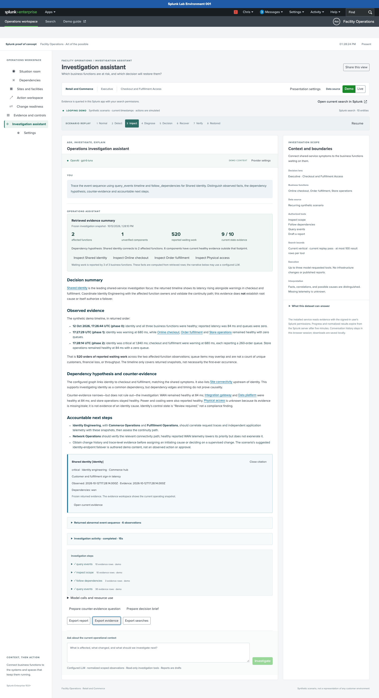

# From observations to an operational decision

Use this walkthrough to demonstrate how Splunk can help a team narrow an investigation, coordinate owners and explain a decision. It requires the installed Facility Operations app; the deterministic assistant requires no LLM credential or live ingestion. For installation, use [getting started](getting-started.md). For a connected model, use [assistant setup](assistant-setup.md).

## A five-minute investigation

1. In **Settings → Presentation setup**, select **Retail and Commerce**, **Executive**, and **Checkout and Fulfillment Access**. Apply the presentation. Keep **Demo** selected, choose **Pause**, then **Impact**.
2. Read **What matters now**. Online checkout and Order fulfillment need attention; three function queues report a combined 520 illustrative order entries. A work item may appear in multiple queues. Nine of ten components have current state evidence; Physical access remains unverified.
3. Read **Start the investigation**. Shared identity has abnormal evidence and a configured path to the two affected functions. This supports a hypothesis. Six components have current healthy evidence outside that path and receive lower investigation priority; they have not been cleared of involvement.
4. Open **What this dataset can answer**. The app can connect state, relationships, owners, latency and queues. It needs independent request traces, application telemetry and change records before establishing cause. This turns a confident-looking display into a reviewable operational conversation.
5. Choose **Investigate priority**. The assistant opens with Shared identity as its focus and a prepared question. Review the question and choose **Investigate**. Scope-wide consequences and gaps remain included.
6. Compare the **Retrieved evidence summary** with the narrative. The summary is computed from retrieved rows. The event sequence contains only observations through Impact in this replay pass: identity becomes abnormal at Detect, then the configured dependent functions become abnormal at Impact. Temporal order supports investigation, not a proven causal conclusion.
7. Inspect an evidence link, or export the report, JSON evidence and searches. The JSON retains the selected component, audience, data mode, timestamps, assessment, data guide and collected results. **Open current search in Splunk** demonstrates the authenticated search behind the workspace.

To show a different question over the same evidence, select **Engineering**, **CISO**, **ISSO** or **Change Control Board** in Settings. Choosing a different audience clears the previous investigation. Audience selection changes the decision lens and grants no permissions.

## Show a connected investigation

With an administrator-configured OpenAI or Ollama model, keep the same paused Demo scope and ask: “Trace the event sequence and dependency hypothesis. Distinguish observations, counter-evidence and accountable next steps.” Watch **Investigation activity** as the service searches Splunk, computes the receipt, calls the model and executes its permitted tools. Expand an activity to inspect the executed SPL. Incremental public answer text appears as a draft; final exports become available only after completion. AI Toolkit shows search/tool activity and its completed response; token streaming through its `ai` command is not implemented.

In the completed answer, select a cited component to inspect frozen returned evidence without leaving the conversation. Expand **Returned abnormal event sequence** to compare timestamps with the hypothesis. **Open current evidence** deliberately leaves the conversation for the workspace's current snapshot; export needed material first.

Choose **Prepare counter-evidence question** or **Prepare decision brief** to fill the composer, review it, and submit. The assistant retains bounded conversation text while querying fresh scoped evidence. **Model calls and resource use** shows the applied reasoning effort, duration and available token counts. Adaptive reasoning can start a brief at low effort and increase effort when tools reveal uncertainty; actual behavior depends on the provider/model.

Use **Stop** to request cancellation. Leaving the assistant or changing audience/data scope also cancels pending work and clears the conversation. Already-running external computation may continue until its timeout. This is a demonstration of investigation and decision support; provider reasoning is private, infrastructure actions remain simulated, and time-to-innocence improvements must be measured in the customer's proof of concept.

## Decisions by audience

| Audience | Useful discussion | Evidence still needed |
| --- | --- | --- |
| Operations | Which owner should start, which functions need coordination, and what is waiting? | Current runbooks, support procedures and independent validation |
| Engineering | Does an abnormal shared dependency precede the symptoms? What evidence could disprove the hypothesis? | Request traces, application telemetry and change history |
| Executive / Continuity | Which functions need attention, who is accountable and what decision supports continuity? | Verified fallback capacity, recovery objectives and business priorities |
| Security / CISO | How could containment affect essential functions? Where are the evidence gaps? | Identity, network and threat evidence; an operational alert alone is not compromise |
| ISSO / Audit | Is state evidence current and attributable? Which control associations need review? | Authoritative controls, exceptions and retained decision records |
| Change Control Board | What could be affected, which evidence blocks a decision and what should verify rollback? | Approved change record, tests, rollback authority and acceptance criteria |
| Facilities | Could a physical condition affect a digital function, and which site and service teams should coordinate? | Sensor thresholds, redundant capacity and site procedures |

## What the data means

The demo contains ten entities per selected vertical/use case, with four layers: business functions, shared services, infrastructure and facilities. Each observation has an entity ID, state, reason, owner, site, relationships, source and evidence time. The eight phases form an authored, repeating story, not a prediction or a customer's incident history.

| Field or result | Interpretation | Avoid claiming |
| --- | --- | --- |
| `state`, `_time`, `evidence_at` | Observed state and timestamps; missing, stale or invalid current evidence remains unknown | No events means healthy; every returned component is observed |
| `queue_depth` | Waiting work per reporting business function; totals can overlap across queues | Unique affected customers, throughput, lost revenue or cost savings |
| `latency_ms` | A reported latency observation where applicable | A percentile, an SLA result or a universal threshold |
| `temperature_c` | An environmental reading where reported; demo temperatures belong to Cooling and environment | A reading for every component or authorization to operate equipment |
| `depends_on` | Configured inventory relationships in the returned scope | Complete environment discovery or proof of root cause |
| `control_id`, `control_state` | Associations and observations supporting a review | Compliance certification or security incident confirmation |
| Lower investigation priority | Current healthy observations outside a candidate dependency footprint | Exoneration or measured reduction in time to innocence |

In Live, the selected use case supplies a question and data guide. It does not change the live events to match the demo or inject the authored root cause. See the [live field contract](live-data.md) for source requirements. An empty result, unknown function state or unreported queue must remain visible as a limitation.

## Interaction and troubleshooting

- **A selected component needs more attention:** use its investigation button in Dependencies, Sites and facilities, or Evidence and controls. The selected ID appears in the assistant; **Use whole scope** clears it and the conversation.
- **An action needs explanation:** use **Review with assistant** in Action workspace or Change readiness. The assistant prepares a review; execution and approvals remain separate demo simulations.
- **A question has been prepared but nothing runs:** review it and choose **Investigate**. Handoffs do not automatically send evidence to a model.
- **The assistant cannot find the selected component:** refresh the data and select a returned component. The service rejects focus IDs outside its returned scope. It returns at most 100 rows per tool, so a larger inventory may need a more specific live source scope.
- **A result is truncated or references missing dependency IDs:** treat the footprint as incomplete. Inspect the trace, refine the source scope, and verify inventory before making an environment-wide claim.
- **The brief changes while a previous answer does not:** the workspace refreshes; an answer is a frozen investigation receipt. Export it before leaving the assistant. Evidence links inspect the component's current state.
- **A connected model fails or offers an unsupported conclusion:** inspect the actual evidence and trace, then use the configured deterministic provider for a repeatable demonstration. There is no automatic provider fallback. Follow [troubleshooting](troubleshooting.md).

Use the [evaluation guide](operations-value.md) to measure triage time, time to innocence, handoffs and decision quality in a customer proof of concept. This demonstration supplies an investigation method and synthetic evidence, not measured customer outcomes.
